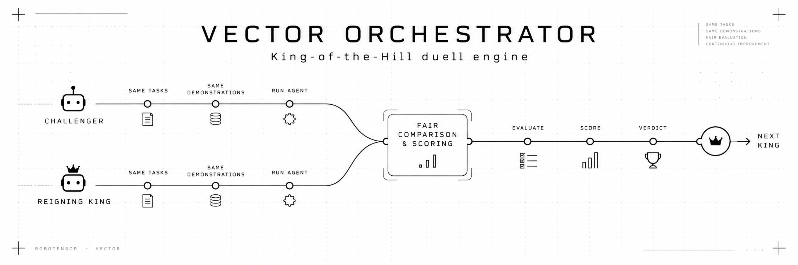

<p align="center">
  
</p>

<p align="center">
  <a href="LICENSE"></a>
  
  
</p>

<p align="center">
  <a href="#how-a-duel-works">How a duel works</a> ·
  <a href="#usage">Usage</a> ·
  <a href="#store-format">Store format</a> ·
  <a href="#tests">Tests</a>
</p>

---

**vector-orchestrator** is the duel engine for **Robotensor Vector**. A challenger plays the
reigning king on the same units and the same demonstrations. The result goes to an append-only
store, which is mirrored to a Hugging Face dataset.

The subnet validator ([robotensor-subnet](https://github.com/robotensor/robotensor-subnet)) runs
the engine. You can also run a single duel by hand with `vector-orchestrator duel`.

## Layout

| Path | Contents |
|---|---|
| `spec.json` | The contract: benchmark checkout, level, the 16 tasks, runs per task, step ratio, crown rule, architecture and time budgets |
| `src/vector_orchestrator/` | Units, duels, scoring, submission fetch and the result store |
| `packages/vector-runtime` | Checks, loads and serves `vector_v1.1` weights |
| `packages/vector-protocol` | Process-isolated policy protocol (numpy + JSON over an authenticated socket) |

## How a duel works

1. **Units.** Each task gets `runs_per_task` units. A unit pairs a demonstration scene with a
   scoring scene. Both are drawn from a hash of the duel id and the seeding chain block.
2. **Demonstrations.** Every unit's demonstration is recorded first, by the benchmark's expert.
   Both sides get exactly the same demonstrations.
3. **Evaluation.** The king plays its units, then the challenger plays the same units.
   [RoboTwin-Vector](https://github.com/robotensor/RoboTwin-Vector) runs from its checkout under
   the simulator's own interpreter and is never imported.
4. **Scoring.** A side's score is its mean success rate over tasks, counting only units that are
   not void. The challenger is crowned when its average leads the king's by `crown.margin` points.
   A duel with more than `crown.max_void` void units is void.
5. **Verdict.** The record is published, and the head names the next king.

**Submissions.** A submission is a Hugging Face repo with `model.safetensors` only. The weights are
checked against the architecture and served by the validator's own code, so no submitted code
runs.

**The throne.** With no king, the first challenger is crowned by a `genesis` event. If a king's
repository is gone, `Orchestrator.vacate` dethrones it without a duel: a `vacate` event empties the
throne, and the next challenger takes it by genesis.

**Hardware.** The engine uses every visible GPU, with `--workers` units per card. Interrupted duels
resume from `runs/<event id>/`.

## Usage

```bash
uv venv --python 3.10 .venv
uv pip install -e ".[dev]" -e packages/vector-protocol -e packages/vector-runtime

export ROBOTWIN_BENCH_ROOT=/path/to/RoboTwin-Vector
export ROBOTWIN_BENCH_PYTHON=/path/to/robotwin/bin/python

vector-orchestrator check
vector-orchestrator store init --root store/
vector-orchestrator duel --store store/ --run-dir runs/ --challenger owner/name@main \
    --policy-python /path/to/policy/bin/python --policy-kwarg device=cuda:0 --workers 1
vector-orchestrator store mirror --root store/ --repo owner/results
```

## Store format

```
manifest.json              store layout version
head.json                  current seq, block and king
queue.json                 validator queue
running.json               the duel running now and how far it has got
champions.json             the models the validator pays now
index-NNNN.jsonl           one line per event: genesis, duel or vacate
events/<event_id>.json     units, per-task scores, verdict, seed block
media/<sha[:2]>/<sha>.mp4  demonstration and rollout clips
```

## Tests

```bash
ruff check . && ruff format --check .
pytest
pytest packages/vector-runtime -m "not gpu"
```

## License

[Apache-2.0](LICENSE)
